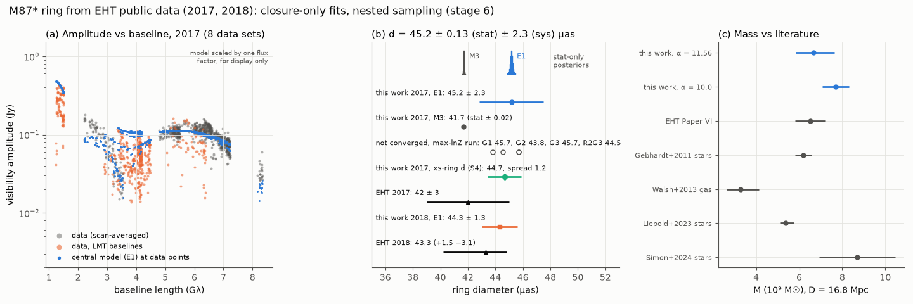

# bh-shadow-lab

A known-answer test on public data: the diameter of the ring in M87* is measured from the calibrated visibilities that the Event Horizon Telescope (EHT) released for its 2017 observations, using closure quantities only, and compared with the EHT's published 42 ± 3 μas. This is a reproduction of a published result, not a new measurement, and it does not produce an image of the black hole.

- Pre-registration and change log (Korean): [docs/PREREGISTRATION.md](docs/PREREGISTRATION.md). The verdict criteria, processing steps and literature values (with page and table numbers) were committed before the data were downloaded. Stages 5, 6 and 7 are additional analyses registered after earlier results were known; they do not change earlier verdicts.
- Theory (English): [docs/THEORY.md](docs/THEORY.md). Pipeline and data notes (Korean): [docs/PIPELINE.md](docs/PIPELINE.md), [docs/DATA.md](docs/DATA.md). The Korean documents refer to internal stage reports that are not part of this repository.

The question and the rules (known-answer test, criteria before data, closure quantities only, every change of procedure recorded with both outcomes) are mine. The code was written and run with AI coding agents under my direction; I reviewed each stage.

## What was done

1. A reader for the uvfits files, checked against the release's own csv tables (largest relative difference 1.2×10⁻⁵); closure phases checked against eht-imaging on 4,008 triangles (largest difference 6×10⁻⁶ degrees).
2. Geometric source models with analytic Fourier transforms, each tested against a pixel DFT: a Gaussian-blurred ring with an m = 1 brightness asymmetry (M3), with an m = 2 term (E2), with one free circular Gaussian (E1), with one to three elliptical Gaussians (G1–G3, R2G3), and the EHT's crescent model (xs-ring).
3. Joint fits of the eight 2017 data sets (four nights, two bands) with emcee and, from stage 6, dynesty nested sampling (three runs per model) under written convergence criteria.
4. An error budget from leave-one-out fits (seven telescopes, four nights, two bands), a processing variant and model comparisons; injection tests on synthetic data; conversion from diameter to mass with the EHT's calibration factor; the same pipeline on the 2018 release.

## Results



| Quantity | This analysis | Published | Verdict (pre-registered rule) |
|---|---|---|---|
| Ring diameter 2017, ring only (M3, stages 1–4) | 41.70 ± 0.36 μas (χ²/ν = 6.97) | 42 ± 3 μas (EHT 2019, Paper VI) | reproduced |
| Ring diameter 2017, ring + Gaussian (E1, stage 6) | 45.2 ± 0.13 (stat.) ± 2.3 (syst.) μas (χ²/ν = 3.05) | 42 ± 3 μas | reproduced (z = 0.83) |
| Ring diameter 2018, E1 | 44.3 ± 0.06 ± 1.3 μas | 43.3 (+1.5 −3.1) μas (EHT 2024) | reproduced (z = 0.51); same as 2017 (z = −0.32) |
| Mass, M3, α = 11.56 | 6.14 (−0.69 +0.85) × 10⁹ M☉ | 6.5 ± 0.7 × 10⁹ M☉ | consistent |
| Mass, E1, α = 11.56 | 6.65 (−0.81 +0.99) × 10⁹ M☉ | 6.5 ± 0.7 × 10⁹ M☉ | consistent |
| First visibility null | 3.87 ± 0.03 Gλ | about 3.4 Gλ (criterion 3.2–3.6) | **not reproduced** |

| Model | Free parameters | Diameter (μas) | χ²/ν | Converged |
|---|---|---|---|---|
| M3, ring only | 10 | 41.70 | 6.97 | yes, under both rules |
| E2, ring + m = 2 | 18 | 43.82 | 5.46 | only under the changed rule |
| E1, ring + 1 circular Gaussian | 14 | 45.16 | 3.05 | only under the changed rule |
| G1, ring + 1 elliptical Gaussian | 16 | 45.64 | 2.56 | no |
| G2 | 22 | 43.87 | 1.65 | no |
| G3 | 28 | 45.14 | 1.35 | no |
| R2G3 | 36 | 44.75 | 1.54 | no |

- Leaving out the LMT moves the ring-only diameter from 41.7 to 45.6 μas. Synthetic tests rejected a gain problem and a baseline-coverage effect and supported a model that is too simple; with the added Gaussian the shift falls to −0.3 μas.
- Injection tests with realistic contamination and structure outside the model give a ring-only diameter 1.6–1.9 μas too small while the error bar stays near 0.1 μas: the ring-only error bar is optimistic.
- Pixel imaging (regularised maximum likelihood, with eht-imaging) did not produce a ring with any of the four closure sets tried.
- Stage 7 (convergence of the larger models, PREREGISTRATION section 12) is in progress. Its first ladder (more live points) did not make G1 converge, so the central model stays E1; a second attempt with more slice steps was registered before it was run.

Result files are in `results/` (JSON per stage, per-fit summaries in `results/stage5_fits/`, `stage6_fits/`, `stage7_fits/`, figures `fig_*.png`).

## Reproducing

Python 3.12. Data download instructions and SHA-256 hashes are in [docs/DATA.md](docs/DATA.md); files go to `data/raw/`, which is git-ignored.

```bash
python -m venv .venv && .venv/bin/pip install -r requirements.txt
.venv/bin/pip install -r requirements-optional.txt     # optional: ehtim cross-checks, scikit-learn for stage 4
.venv/bin/python -m pytest                             # 52 pass without the data, 23 data-based tests are skipped
.venv/bin/python scripts/run_stage1.py                 # reader checks, closure quantities, first null (about 15 s)
.venv/bin/python scripts/run_stage2.py                 # ring fits and mass (about 5 min)
.venv/bin/python scripts/run_stage3.py                 # injection tests (about 45 min)
.venv/bin/python scripts/run_stage5_systematics.py     # stage 5: jackknife, extended models, budget
.venv/bin/python scripts/run_stage6_models.py          # stage 6: nested sampling of seven models (about 5.5 h)
.venv/bin/python scripts/run_stage6_systematics.py
.venv/bin/python scripts/run_stage6_2018.py
.venv/bin/python scripts/run_stage6_summary.py         # summary figure
```

The full list of scripts, their order and run times is in [docs/PIPELINE.md](docs/PIPELINE.md). All seeds are fixed in the scripts. Sampler chains and checkpoints are not in the repository. The 23 skipped tests need the downloaded data. I have not tested a full rebuild on a second machine.

## Data

| Data | Where from | Terms (checked 2026-11-17) | Citation |
|---|---|---|---|
| First M87 EHT Results: Calibrated Data (2017 observations, release 2019-D01-01) | github.com/eventhorizontelescope/2019-D01-01 (the same release as doi:10.25739/g85n-f134 at CyVerse) | the release's LICENSE.txt: "The data files in this data set are licensed under the ODC-PDDL license"; its scripts are GPLv3 and are neither used nor copied here | The Event Horizon Telescope Collaboration 2019. First M87 EHT Results: Calibrated Data. CyVerse Data Commons. DOI 10.25739/g85n-f134. Primary reference: EHT Collaboration et al. 2019, ApJL 875, L3 (Paper III) |
| M87 2018 calibrated data (release 2024-D01-01) | github.com/eventhorizontelescope/2024-D01-01 | same LICENSE.txt wording: data files under ODC-PDDL, scripts GPLv3 (not used) | EHT Collaboration et al. 2024, A&A 681, A79, doi:10.1051/0004-6361/202347932 |

No raw data are in this repository. The `results/closure_*.csv` files hold closure quantities computed from the 2017 data; the ODC-PDDL is a public-domain dedication, so derived tables may be shared. Published values used for comparison (EHT Paper VI: ApJL 875, L6; Gebhardt et al. 2011; Walsh et al. 2013; Liepold et al. 2023; Simon et al. 2024) are cited with page and table numbers in docs/PREREGISTRATION.md. No EHT image is used anywhere in this repository.

## Limits

- The central model (E1) was selected under a convergence rule that I changed during the run, after the M3 and E1 results had been seen. Under the rule registered beforehand the central model is M3, at 41.7 μas.
- The 2.3 μas systematic uncertainty contains no model term, because no converged comparison model was available. Counting the models that did not converge would raise it to about 2.7 μas. The largest term is the processing variant (1.95 μas).
- The models that fit best (two or three Gaussians) did not converge; their diameters (43.8–45.7 μas across runs) are not results.
- The added Gaussian in E1 has no confirmed physical meaning; it moves when the processing or the set of telescopes changes.
- My xs-ring implementation gives diameters 1.4 μas larger on average than the EHT's per-day values; the difference is unexplained and none of those eight fits converged.
- The mass uses a calibration factor (α) that the EHT derived for its own crescent model; it was not calibrated for the models here.
- Closure data alone did not force a dark centre in pixel images, so the diameter is measured under the assumption of a ring model.
- The published value was known throughout. Pre-registration guarantees only that the criteria were fixed before this project's own numbers existed.

## Licence

Code: MIT (see [LICENSE](LICENSE)). The EHT data remain under their own terms (above).
